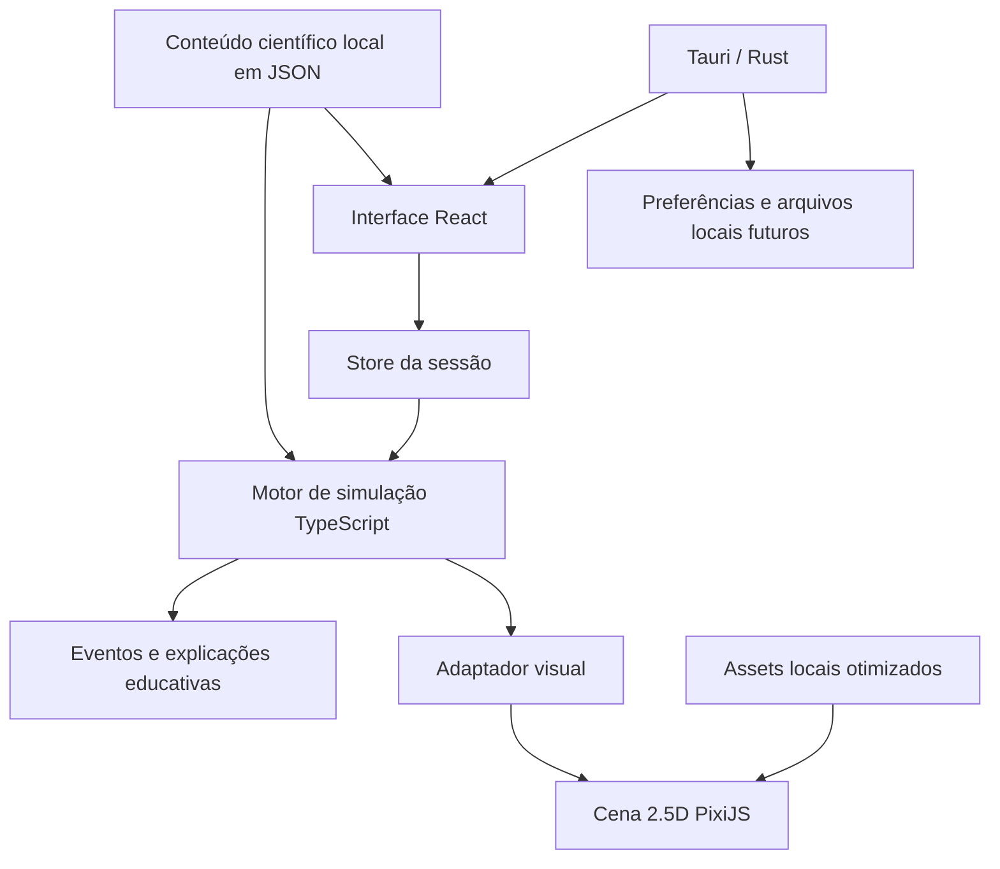

# Laboratório Digital Marinho — Plano Técnico do Aplicativo Offline

**Documento para alinhamento e apresentação ao time**  
**Status:** implementação ativa na branch `codex/scientific-ui-overhaul`
**Versão:** 1.2
**Data:** 19 de outubro de 2026

---

## 0. Progresso da implementação

| Entrega | Estado |
|---|---|
| Permanência no 2.5D | Decidido |
| Relógio em dias, meses e anos | Implementado |
| Velocidades 1×, 2×, 3×, 5× e 10× | Implementado |
| Pausa da simulação | Implementado |
| Exposição acumulada | Implementado — primeira calibração educativa |
| Peixe com deformação por malha | Implementado — primeira espécie |
| Curva e inversão gradual de direção | Implementado |
| Morte dinâmica dos peixes | Implementado — primeira versão |
| Estados progressivos dos corais | Implementado — primeira versão |
| Auditoria automática de dependências de rede | Implementado |
| Base Tauri desktop | Implementado |
| Instalador Windows NSIS com WebView2 offline | Configurado; requer build e teste em Windows |
| Missões educativas | Planejado |
| Fichas científicas de espécies | Planejado |
| Validação científica dos parâmetros | Pendente |
| Testes em computadores escolares | Pendente |

---

## 1. Resumo executivo

O Laboratório Digital Marinho será reconstruído como um **aplicativo desktop educacional, offline e 2.5D**, voltado inicialmente para uso de professores em computadores Windows de escolas baianas.

A experiência continuará utilizando tecnologias web na camada visual, porém será executada dentro de uma janela nativa empacotada com **Tauri 2**. O usuário não precisará abrir um navegador, acessar uma URL, criar uma conta ou estar conectado à internet. Todos os recursos necessários para a aula — aplicação, artes, textos, referências e parâmetros da simulação — estarão no instalador.

A direção definida é:

- manter o oceano em **2.5D**, evitando o custo e a complexidade de produzir animais e recifes completos em 3D;
- reconstruir a cena para parecer um ecossistema vivo, não apenas uma ilustração que troca de imagem;
- animar peixes com deformação do corpo, cauda e nadadeiras, sem exigir modelos 3D ou esqueletos complexos;
- representar estresse, branqueamento, mortalidade e recuperação como processos graduais;
- usar **tempo simulado em dias, meses ou anos**, exibindo uma única unidade adequada à duração;
- permitir velocidades de **1×, 2×, 3×, 5× e 10×**;
- manter o motor científico separado da interface e da cena;
- funcionar integralmente offline durante instalação e uso;
- priorizar um único recife baiano muito bem desenvolvido antes de adicionar novos ambientes.

---

## 2. Problema que a nova versão deve resolver

O MVP atual validou a interação básica: selecionar pressões ambientais, ajustar intensidades e observar respostas do ecossistema. Entretanto, ele ainda apresenta limitações importantes:

1. a estética se aproxima de uma ilustração infantil;
2. a cena possui pouca profundidade, variação e vida própria;
3. os movimentos dos organismos ainda não comunicam comportamento animal;
4. as consequências são rápidas e pouco ligadas a uma escala temporal compreensível;
5. branqueamento, morte e recuperação ainda aparecem como mudanças visuais simplificadas;
6. os indicadores são genéricos e não explicam suficientemente a cadeia de causa e efeito;
7. a entrega como site pressupõe disponibilidade de internet;
8. parte das escolas-alvo possui conectividade limitada ou inexistente;
9. a estrutura atual nasceu como prova de conceito e não deve ser expandida indefinidamente.

A reconstrução deve transformar o produto em um **laboratório científico imersivo**, com a fluidez visual de um jogo, a clareza de um painel de monitoramento e o rigor de uma ferramenta educativa que explicita suas simplificações.

---

## 3. Decisões já tomadas

| Tema | Decisão |
|---|---|
| Plataforma principal | Aplicativo desktop para Windows |
| Funcionamento | 100% offline durante instalação e uso |
| Empacotamento | Tauri 2 |
| Interface | React + TypeScript |
| Cena | PixiJS 8 em 2D/2.5D |
| Modelo científico | TypeScript puro, determinístico e independente da interface |
| Direção visual | Científica, sóbria e inspirada em documentários/monitoramento ambiental |
| Animais | 2.5D no runtime atual; piloto 3D ortográfico ou pré-renderizado será decidido por benchmark |
| Tempo | Escala contínua em dias, formatada como dias, meses ou anos |
| Velocidade | 1×, 2×, 3×, 5× e 10× |
| Dados externos | Nenhuma consulta obrigatória em tempo de execução |
| Backend, login e nuvem | Fora da primeira versão offline |
| Primeiro cenário | Um recife costeiro baiano altamente desenvolvido |

---

## 4. O que significa “refazer o `index.html`”

O arquivo atual será **substituído durante a reconstrução**, mas não poderá ser eliminado se mantivermos React, Vite, PixiJS e Tauri.

Tauri não abre um navegador comum. Ele cria uma janela nativa e hospeda dentro dela um WebView local. Esse WebView precisa receber arquivos estáticos — HTML, CSS e JavaScript — e o `index.html` é somente o ponto de entrada mínimo desse frontend. Ele não representa publicação na internet e não cria dependência de rede.

Na nova base, o arquivo terá somente:

- metadados essenciais;
- o contêiner raiz do React;
- a referência ao módulo de inicialização;
- uma mensagem para o caso excepcional de JavaScript indisponível.

Não haverá lógica de negócio, estilos improvisados, conteúdo da interface, dependências externas ou scripts remotos no HTML.

Remover totalmente o HTML exigiria abandonar React e PixiJS e reconstruir a interface com uma biblioteca nativa em Rust, como Slint ou egui. Isso elevaria muito o custo, reduziria o reaproveitamento do trabalho atual e não traria vantagem proporcional para o MVP. Portanto, essa alternativa está descartada.

---

## 5. Stack definitiva proposta

### 5.1 Linguagens

| Linguagem | Responsabilidade |
|---|---|
| TypeScript | Interface, motor da simulação, sistemas visuais e regras educativas |
| Rust | Inicialização, segurança e recursos nativos do aplicativo Tauri |
| HTML | Bootstrap mínimo da janela local |
| CSS | Layout, acessibilidade e sistema visual |
| SVG/XML | Arquivos-fonte vetoriais, ícones e elementos adequados a vetor |
| JSON | Conteúdo científico, cenários, parâmetros e referências locais |

### 5.2 Frameworks, bibliotecas e ferramentas

| Camada | Escolha | Motivo |
|---|---|---|
| Aplicativo desktop | Tauri 2 | Empacotamento nativo leve e compatível com frontend Vite |
| Interface | React 19 | Componentes, estados de tela, acessibilidade e organização do painel |
| Tipagem | TypeScript em modo estrito | Contratos claros entre simulação, cena e interface |
| Renderização 2.5D | PixiJS 8 | Sprites, meshes, partículas, filtros e aceleração por GPU |
| Build do frontend | Vite | Build estático compatível com Tauri e desenvolvimento rápido |
| Testes unitários | Vitest | Fórmulas, transições, tempo e conteúdo estruturado |
| Testes de fluxo | Playwright | Interações, acessibilidade e regressões visuais |
| Testes nativos | Cargo | Compilação e testes da camada Rust/Tauri |
| Qualidade | ESLint + Prettier | Padronização futura do código e verificação automatizada |
| Otimização de SVG | SVGO | Normalização dos vetores-fonte antes da geração dos assets de runtime |

### 5.3 O que não entra inicialmente

- Three.js ou React Three Fiber no produto principal antes de um piloto com uma espécie;
- motor de física 3D;
- Tailwind, se o sistema visual puder ser atendido por CSS modular e tokens;
- GSAP, enquanto o ticker do PixiJS e animações CSS forem suficientes;
- Zustand ou Redux, enquanto um reducer/store pequeno e tipado for suficiente;
- banco de dados, autenticação ou Supabase;
- chamadas a APIs externas;
- atualização automática obrigatória pela internet;
- fontes, imagens, bibliotecas ou vídeos hospedados em CDN.

A regra será adicionar uma dependência somente quando houver um problema concreto que ela resolva melhor do que a base já escolhida.

---

## 6. Arquitetura-alvo



### 6.1 Princípio de separação

O motor da simulação não poderá importar React, PixiJS ou APIs do Tauri. Ele receberá estado e tempo, calculará o próximo estado e produzirá eventos. Isso permitirá:

- testar os cálculos sem abrir a interface;
- acelerar o tempo sem alterar a renderização;
- reproduzir um cenário a partir de uma semente;
- trocar a arte sem mudar o modelo científico;
- comparar dois cenários usando o mesmo motor;
- revisar parâmetros com especialistas sem reescrever a tela.

### 6.2 Estrutura de pastas prevista

```text
src/
├── app/                    # bootstrap, rotas internas e composição principal
├── ui/
│   ├── components/         # botões, cards, sliders, tooltips e modais
│   ├── panels/             # controles, monitoramento e linha do tempo
│   ├── screens/            # início, laboratório e missões futuras
│   └── styles/             # tokens, temas e estilos modulares
├── scene/
│   ├── core/               # aplicação Pixi, câmera e ciclo de renderização
│   ├── systems/            # peixes, corais, partículas, óleo, luz e água
│   ├── rigs/               # rigs 2.5D e pontos de articulação
│   └── adapters/           # tradução do estado científico para o visual
├── simulation/
│   ├── model/              # ambiente, organismos e exposições
│   ├── time/               # relógio, velocidades e formatação
│   ├── scenarios/          # condições iniciais e objetivos
│   ├── events/             # limiares e mensagens de causa e efeito
│   └── tests/              # testes determinísticos
├── content/
│   ├── species/            # fichas locais de espécies
│   ├── lessons/            # missões e conteúdo pedagógico
│   ├── references/         # bibliografia local
│   └── parameters/         # parâmetros versionados e suas fontes
├── assets/
│   ├── source/             # SVGs e artes editáveis originais
│   └── runtime/            # texturas, atlases e arquivos otimizados
└── infrastructure/         # persistência local e integrações Tauri futuras

src-tauri/                  # camada nativa, criada apenas na fase de implementação
tests/e2e/                  # fluxos completos e regressão visual
```

Não será adotado um monorepo nesta etapa. Um único aplicativo com limites internos claros é suficiente.

---

## 7. Estratégia visual 2.5D

### 7.1 Por que não migrar toda a cena para 3D agora

Modelos 3D convincentes exigiriam:

- modelagem específica das espécies;
- texturas e materiais;
- rig e skinning;
- animações de nado, curva, fuga, estresse e morte;
- iluminação e câmera tridimensionais;
- otimização para computadores escolares;
- validação anatômica e artística;
- muito mais tempo de produção e revisão.

Além disso, encontrar modelos prontos de espécies e corais representativos da Bahia, com licença adequada, estilo coerente e rigs compatíveis, é improvável. Misturar modelos de fontes distintas também prejudicaria a identidade visual.

O 2.5D oferece a melhor relação entre realismo, desempenho e prazo.

Isso não impede usar modelos 3D na produção artística. Há duas rotas de baixo risco:

1. animar e iluminar o peixe no Blender e exportar atlas 2D com transparência; o aplicativo continua usando PixiJS e ganha volume visual sem custo 3D em sala;
2. criar um piloto com uma única espécie GLB no Three.js, câmera ortográfica e fundo transparente, medindo FPS, memória e tempo de carga nos computadores-alvo.

A segunda rota só entra no produto se superar o atlas pré-renderizado em leitura visual e continuar estável no hardware mínimo. O motor científico e a interface permanecem iguais nas duas opções.

### 7.2 Camadas de profundidade da cena

A cena será formada por planos com velocidades, escalas, contraste e desfoque diferentes:

1. superfície, reflexos e ondulação;
2. partículas suspensas e raios de luz;
3. silhuetas e cardumes distantes;
4. organismos no plano médio;
5. recife principal e peixes interativos;
6. elementos próximos à câmera;
7. filtros ambientais, óleo e turbidez.

O parallax será sutil. A meta é comunicar volume e profundidade sem parecer um cenário de papel recortado.

### 7.3 Iluminação e água

- gradiente de absorção da luz com a profundidade;
- raios volumétricos discretos;
- caustics lentas sobre organismos e fundo;
- partículas com densidade dependente da turbidez;
- contraste menor nos planos distantes;
- mudança de cor baseada no estado ambiental, sem usar apenas um filtro global;
- mancha de óleo concentrada na superfície, com gotículas na coluna d'água quando o cenário justificar;
- microplásticos apresentados com escala visual educativa, explicitamente não literal.

---

## 8. Peixes 2.5D e movimento realista

### 8.1 Não é necessário um esqueleto 3D

Os peixes não precisarão de modelos tridimensionais nem de ossos tradicionais. Cada espécie terá um **rig 2.5D leve**, formado por arte lateral e pontos de articulação.

Dividir o peixe apenas em cabeça, corpo e cauda produziria dobradiças visíveis e movimento robótico. A composição recomendada é:

| Parte | Tratamento |
|---|---|
| Cabeça e parte frontal do tronco | Camada quase rígida |
| Corpo médio e traseiro | Mesh subdividida com deformação suave |
| Pedúnculo caudal | Área de maior flexão |
| Nadadeira caudal | Camada separada com pivô próprio |
| Nadadeiras peitorais | Camadas separadas para manobra e frenagem |
| Nadadeiras dorsal e anal | Movimento menor e secundário |
| Luz, sombra e brilho | Camadas que reforçam volume e orientação |

O `MeshPlane`/mesh do PixiJS permitirá deformar a textura do corpo em vários segmentos, criando uma onda contínua. A cauda será articulada separadamente para ampliar o movimento sem quebrar a silhueta.

### 8.2 Regra básica do nado

A deformação seguirá uma onda cujo movimento aumenta em direção à cauda:

```text
deslocamento(x, t) = amplitude(x) × sin(frequência × t + fase(x))
```

- a cabeça quase não oscila;
- a amplitude aumenta ao longo do corpo;
- a frequência cresce quando o peixe acelera;
- a cauda acompanha a direção real do deslocamento;
- ao inverter a direção, a arte é espelhada somente depois da curva/transição;
- a velocidade de animação será ligada à velocidade do peixe, evitando “nadar parado”.

### 8.3 Comportamento de deslocamento

O sistema combinará regras leves de steering/boids:

- separação para evitar sobreposição;
- alinhamento com peixes próximos;
- coesão do cardume;
- desvio suave das bordas e do recife;
- preferência por faixa de profundidade da espécie;
- pequenas diferenças individuais de velocidade e fase;
- fuga diante de perturbação intensa;
- redução de velocidade e perda de coesão sob estresse;
- curvas graduais, nunca inversões instantâneas.

### 8.4 Estados comportamentais

```text
CRUISING → FORAGING → ALERT → FLEEING
     ↓          ↓         ↓
  STRESSED → WEAKENED → DYING → DEAD
```

As transições dependerão de exposição acumulada, saúde, espécie e aleatoriedade determinística. Nem todos os peixes reagirão no mesmo instante.

### 8.5 Morte dinâmica

A morte não será apenas uma troca de sprite. A sequência prevista é:

1. perda de velocidade e afastamento do cardume;
2. oscilação irregular e dificuldade de manter a orientação;
3. inclinação progressiva;
4. imobilização;
5. deriva conforme a corrente e, conforme o caso, afundamento ou subida;
6. permanência temporária na cena;
7. remoção visual gradual.

Se o ambiente melhorar, indivíduos mortos não voltarão. Uma recuperação futura da população será apresentada como **recrutamento/migração de novos indivíduos**, após um atraso ecológico e com habitat adequado.

---

## 9. Corais: branqueamento, mortalidade e recuperação

### 9.1 Estados visuais necessários

Cada colônia será tratada individualmente e poderá passar por:

```text
SAUDÁVEL
  → PÁLIDO
  → PARCIALMENTE BRANQUEADO
  → BRANQUEADO, AINDA VIVO
  → PERDA PARCIAL DE TECIDO
  → MORTO RECENTE
  → COLONIZADO POR ALGAS/SEDIMENTO
```

Um coral branco não deverá ser apresentado automaticamente como morto. O branqueamento representa uma condição de estresse que pode ser reversível se a pressão diminuir a tempo.

### 9.2 Técnica visual

- máscaras irregulares por colônia, em vez de um crossfade uniforme da cena inteira;
- progressão em manchas, pontas ou regiões expostas;
- variação individual de sensibilidade;
- redução gradual de saturação antes do branco;
- textura de tecido ausente nos estados de mortalidade;
- algas e sedimento surgindo somente depois de um intervalo;
- movimento discreto de pólipos e organismos associados;
- resposta à corrente para espécies ramificadas e algas próximas.

### 9.3 Modelo de recuperação

- coral pálido ou branqueado poderá recuperar cor lentamente se a exposição cessar;
- a recuperação terá atraso e será mais lenta que o dano;
- tecido perdido não retornará instantaneamente;
- colônia morta não será restaurada dentro do mesmo experimento;
- restauração ativa será um cenário próprio, não um botão mágico de cura.

---

## 10. Tempo da simulação

### 10.1 Unidade interna

O motor trabalhará sempre com **dias simulados** como unidade canônica:

```text
simulatedDays += realDeltaSeconds × daysPerRealSecond × speedMultiplier
```

Proposta inicial para testes pedagógicos:

```text
4 segundos reais = 1 dia simulado em 1×
```

Assim, um ano leva aproximadamente 6 minutos em 1× e 36 segundos em 10×. Esse valor será calibrado em testes de aula e não ficará espalhado pelo código.

### 10.2 Velocidades

| Controle | Uso esperado |
|---|---|
| 1× | observar processos curtos e explicar mudanças |
| 2× | acompanhamento moderado |
| 3× | avanço de atividades comuns |
| 5× | observar tendências de meses |
| 10× | alcançar consequências de longo prazo |

O usuário também poderá pausar. Alterar a velocidade não mudará as fórmulas nem o resultado científico; mudará somente a rapidez com que o relógio simulado avança.

### 10.3 Exibição em dias, meses ou anos

A interface mostrará uma única unidade por vez:

```text
menos de 45 dias       → N dias
de 45 a 364 dias       → N meses
365 dias ou mais       → N anos
```

Conversões de apresentação:

```text
meses = dias / 30,4375
anos  = dias / 365,25
```

Exemplos:

- `18 dias`;
- `4,2 meses`;
- `2,6 anos`.

A gravidade não escolherá diretamente a unidade. Ela determinará **quanto tempo o efeito leva para ocorrer**. Efeitos intensos cruzarão os limiares em poucos dias; efeitos crônicos poderão aparecer depois de meses ou anos. O formatador escolherá a unidade com base no tempo calculado.

### 10.4 Exposição acumulada

As consequências não serão disparadas apenas porque um slider cruzou um valor. Cada pressão acumulará uma dose de exposição:

```text
dose += intensidadeNormalizada × vulnerabilidade × duraçãoEmDias
```

Estados visuais e biológicos surgirão quando doses específicas forem atingidas. Isso permite que:

- uma pressão severa gere efeitos rapidamente;
- uma pressão moderada gere efeitos depois de mais tempo;
- uma pressão curta possa não produzir mortalidade;
- combinações de pressões criem sinergias;
- a recuperação dependa do histórico, não apenas do valor atual.

### 10.5 Exemplo do óleo

“9 toneladas de óleo” não é informação suficiente para prever um impacto sem conhecer área atingida, dispersão, tipo de óleo, ambiente e duração. Para evitar falsa precisão, o modelo deverá usar um cenário documentado, por exemplo:

```text
cargaAreal = massaDeÓleo / áreaAfetada
doseDeÓleo += cargaArealNormalizada × exposição × dias
```

A interface poderá apresentar a massa do cenário, mas deverá explicar que o resultado é educativo e condicionado às premissas. Até existir calibração científica, poluentes permanecerão em escala relativa ou em cenários fechados validados.

---

## 11. Motor ambiental e ecológico

### 11.1 Separação de variáveis

```text
Drivers escolhidos pelo usuário
  ↓
Estado físico-químico do ambiente
  ↓
Exposição acumulada por organismo
  ↓
Resposta biológica
  ↓
Eventos educativos e representação visual
```

Isso evita regras incorretas como “adicionar qualquer poluição reduz diretamente o pH” ou “atingir determinada temperatura mata todos os peixes”.

### 11.2 Pressões iniciais

| Pressão | Representação inicial | Observação |
|---|---|---|
| Temperatura | valor, anomalia e exposição térmica acumulada | Basear a lógica em intensidade e duração |
| Acidificação | pH e exposição de organismos sensíveis | Não associar automaticamente a qualquer poluente |
| Óleo | carga relativa, superfície, coluna d'água e duração | Cenários precisam declarar premissas |
| Microplásticos | concentração/índice relativo e exposição | Partículas da cena são representação ampliada |

### 11.3 Evoluções posteriores

- oxigênio dissolvido;
- turbidez e sedimentos;
- nutrientes/eutrofização;
- esgoto;
- pesca e pressão sobre grupos funcionais;
- perda de habitat;
- restauração ambiental;
- salinidade quando houver cenário em que seja relevante;
- correntes e dispersão espacial simplificada.

### 11.4 Nível de evidência

Cada regra ou parâmetro deverá ser classificado como:

1. **demonstrativo** — relação qualitativa para ensino;
2. **baseado em literatura** — comportamento derivado de estudos, ainda não calibrado localmente;
3. **calibrado** — ajustado com dados e revisado por especialista.

A interface e a documentação devem deixar claro que o aplicativo não é uma previsão oceanográfica.

---

## 12. Nova interface

### 12.1 Organização da tela

- **centro, 65–70%:** recife e organismos;
- **lateral direita, 25–30%:** controles, variáveis e explicações;
- **barra inferior:** linha do tempo, pausa, velocidade e comparação;
- **cabeçalho reduzido:** cenário, estado da sessão e reinício.

O oceano será o elemento dominante. A interface não deverá disputar atenção com a cena.

### 12.2 Direção visual

- azul-marinho profundo, azul-petróleo, cinza-ardósia e branco suave;
- verde reservado a condição saudável;
- amarelo, laranja e vermelho apenas para atenção e dano;
- tipografia local legível em projetores;
- cards compactos e hierarquia de informação clara;
- menos cantos excessivamente arredondados e ícones lúdicos;
- animações de interface discretas e funcionais;
- linguagem adequada a adolescentes e adultos, sem parecer infantil.

### 12.3 Monitoramento

Substituir a dependência exclusiva das barras genéricas por informações como:

- temperatura atual e anomalia;
- pH;
- tempo de exposição;
- cobertura de coral vivo;
- proporção de coral branqueado;
- população/atividade de peixes;
- qualidade do habitat;
- histórico do cenário;
- explicação “Por que isso aconteceu?”.

Os indicadores sempre terão rótulo, unidade, definição e origem do cálculo.

### 12.4 Acessibilidade

- todos os controles no DOM, não desenhados dentro do canvas;
- uso completo por teclado;
- foco visível;
- contraste AA;
- valores em texto, sem depender somente de cores;
- descrições textuais do estado do ecossistema;
- região `aria-live` com moderação para eventos relevantes;
- opção para reduzir movimento;
- opção para reduzir partículas e efeitos em computadores mais fracos;
- tamanho mínimo de fonte apropriado a sala e projetor.

---

## 13. Camada educacional

### 13.1 Modos de uso

**Exploração livre**

O professor ou estudante combina fatores, formula hipóteses e observa resultados.

**Missões guiadas**

Atividades com objetivo, hipótese, procedimento, observação e conclusão. Missões inicialmente propostas:

1. O que acontece quando o oceano aquece?
2. O derramamento de óleo.
3. O caminho do plástico.
4. Por que os peixes desapareceram?
5. Um oceano mais ácido.
6. Como um recife pode se recuperar?

### 13.2 Fichas científicas

Ao selecionar um organismo, a aplicação poderá apresentar:

- nome comum e científico;
- ocorrência e contexto no litoral baiano;
- função ecológica;
- alimentação e habitat;
- sensibilidade às pressões do cenário;
- fontes bibliográficas locais;
- nível de evidência das regras usadas na simulação.

### 13.3 Uso em uma aula

Uma missão deve caber em 15–25 minutos e permitir uma aula completa em 30–50 minutos:

1. observar o estado inicial;
2. formular uma hipótese;
3. alterar uma variável;
4. avançar o tempo;
5. registrar evidências;
6. explicar a cadeia de causa e efeito;
7. discutir limitações do modelo;
8. propor medidas de proteção.

---

## 14. Artes e pipeline de assets

### 14.1 Organização

As artes editáveis serão separadas dos arquivos usados pelo aplicativo:

- `assets/source`: SVGs originais, arquivos mestres e documentação;
- `assets/runtime`: texturas otimizadas, atlases e versões rasterizadas quando necessário.

A pasta não deverá ser chamada `svg` se contiver PNGs. Extensão, formato e nome precisam corresponder ao conteúdo real.

### 14.2 Convenção de nomes

```text
grupo-especie-parte-estado-versao.ext
```

Exemplos:

```text
fish-blue-tang-body-healthy-v01.svg
fish-blue-tang-tail-stressed-v01.svg
coral-brain-colony-bleached-v02.png
environment-reef-foreground-rocks-v01.webp
```

### 14.3 Entrega necessária por peixe

- corpo frontal;
- região deformável do corpo;
- cauda;
- nadadeiras móveis;
- máscaras de sombra e brilho;
- versões de cor/lesão quando realmente necessárias;
- pivôs e âncoras documentados;
- mesma escala, orientação e enquadramento entre estados.

### 14.4 Desempenho

- carregar uma textura por espécie/estado e compartilhá-la entre instâncias;
- usar atlas quando reduzir trocas de textura;
- limitar resolução conforme o tamanho real na tela;
- evitar filtros caros em cada indivíduo;
- usar níveis de qualidade;
- medir FPS, memória e tempo de carregamento em computador escolar real.

---

## 15. Funcionamento 100% offline

### 15.1 Requisitos de runtime

O aplicativo instalado deverá:

- iniciar sem rede;
- carregar todos os assets sem rede;
- executar todas as simulações sem rede;
- apresentar textos, missões e referências sem rede;
- usar fontes locais ou fontes do sistema;
- não chamar APIs, CDNs, analytics ou telemetria;
- não depender de login;
- não abrir documentação externa durante a aula;
- continuar funcionando depois de reiniciar o computador desconectado.

### 15.2 Instalador Windows

O instalador será gerado em Windows, preferencialmente por CI e também validado em uma máquina física. A configuração prevista do Tauri usará o modo `offlineInstaller` do WebView2. Esse modo aumenta o instalador em aproximadamente 127 MB, porém permite instalação sem conexão.

Distribuição prevista:

- instalador `.exe` NSIS como entrega do MVP;
- `.msi` somente no futuro, se houver necessidade administrativa nas escolas;
- cópia por pendrive, rede local ou mídia institucional;
- checksum SHA-256 publicado junto de cada versão;
- manual PDF/HTML incluído localmente.

### 15.3 Segurança

- Content Security Policy bloqueando conexões não autorizadas;
- capacidades Tauri mínimas;
- nenhum comando de shell disponível ao frontend;
- navegação externa bloqueada por padrão;
- dependências auditadas e versões fixadas por lockfiles;
- assinatura de código quando houver orçamento/certificado;
- dados de estudantes não serão coletados na primeira versão.

### 15.4 O que “offline” não significa

O desenvolvimento e a geração do instalador podem precisar de internet para baixar dependências. A garantia offline se refere à **instalação e ao uso nas escolas**. Para builds totalmente reproduzíveis sem rede, será necessário manter um cache interno de dependências, etapa posterior de infraestrutura.

---

## 16. Qualidade e testes

### 16.1 Testes do motor

- resultado independente da taxa de quadros;
- passo fixo e relógio simulado;
- equivalência do resultado entre 1× e 10×;
- formatação exclusiva em dias, meses ou anos;
- exposição acumulada e limiares;
- sinergias entre pressões;
- recuperação mais lenta que o dano;
- impossibilidade de “ressuscitar” indivíduos mortos;
- reprodutibilidade com semente fixa;
- limites numéricos e ausência de `NaN`;
- classificação do nível de evidência de todos os parâmetros.

### 16.2 Testes da cena

- direção visual do peixe corresponde ao deslocamento;
- velocidade da cauda acompanha a velocidade do peixe;
- curvas não invertem a arte instantaneamente;
- estados de coral aparecem na ordem correta;
- branqueado não é rotulado automaticamente como morto;
- partículas respeitam o nível de qualidade;
- cena mantém legibilidade em estados extremos.

### 16.3 Testes offline

- instalar em Windows sem internet;
- executar com adaptador de rede desabilitado;
- inspecionar e falhar o build se houver URL remota em código de runtime;
- bloquear solicitações de rede e executar todos os fluxos;
- reiniciar o computador e reabrir a aplicação;
- testar instalação por pendrive;
- validar Windows 10 e 11 em hardware real.

### 16.4 Metas iniciais de desempenho

| Métrica | Meta |
|---|---|
| Resolução mínima | 1024 × 700 |
| Resolução-alvo | 1366 × 768 e 1920 × 1080 |
| FPS | 60 ideal; 30 mínimo estável no modo econômico |
| Tempo até a tela utilizável | até 5 segundos no hardware-alvo |
| Uso sem rede | 100% dos fluxos do MVP |
| Travamentos em aula de 50 min | zero |

As metas serão revisadas depois de escolher o computador escolar de referência.

---

## 17. Estratégia de reconstrução

Não faremos uma refatoração interminável sobre o MVP. Ele será preservado como referência funcional, e a nova base será construída por fatias verticais.

### Fase 0 — validação do plano

- revisar este documento com produto, design, arte, educação e ciência;
- confirmar público e faixa escolar;
- escolher o computador Windows de referência;
- confirmar espécies e cenário baiano;
- definir quem valida o conteúdo científico;
- fechar escopo da primeira entrega.

### Fase 1 — fundação técnica offline

- criar nova base React + TypeScript + PixiJS + Tauri;
- substituir o `index.html` pelo bootstrap mínimo;
- configurar TypeScript estrito, lint e testes;
- configurar instalador Windows offline;
- implementar auditoria automática de rede;
- criar pipeline de assets e conteúdo local.

**Critério de saída:** aplicativo vazio/diagnóstico instala e abre em Windows desconectado.

### Fase 2 — fatia visual 2.5D

- uma espécie de peixe com rig completo;
- uma colônia de coral com todos os estados;
- água, luz, profundidade e corrente;
- relógio, pausa e velocidades;
- painel visual mínimo.

**Critério de saída:** cena demonstra nado, curva, estresse, branqueamento e morte com desempenho aceitável.

### Fase 3 — motor científico

- temperatura e exposição térmica acumulada;
- óleo;
- microplásticos;
- pH/acidificação;
- respostas específicas de corais e peixes;
- eventos educativos e histórico;
- documentação de premissas e nível de evidência.

**Critério de saída:** cenários reproduzíveis, testados e revisados por especialista.

### Fase 4 — experiência pedagógica

- exploração livre;
- primeira missão completa;
- fichas científicas;
- “Por que isso aconteceu?”;
- comparação antes/depois;
- acessibilidade e testes em projetor.

**Critério de saída:** professor consegue conduzir uma aula sem suporte da equipe.

### Fase 5 — piloto nas escolas

- instalação presencial/offline;
- observação de aulas;
- registro de compreensão antes e depois;
- coleta de dificuldades de uso;
- correções de conteúdo, UX e desempenho;
- preparação do pacote de distribuição.

---

## 18. Priorização

### P0 — indispensável para a próxima versão

- aplicativo Windows offline;
- cena 2.5D reconstruída;
- um peixe com rig convincente;
- coral com branqueamento e mortalidade gradual;
- tempo simulado e velocidades;
- quatro pressões atuais com exposição acumulada;
- explicações de causa e efeito;
- acessibilidade básica;
- testes científicos, visuais e offline.

### P1 — alto valor após a fatia principal

- mais espécies do recife baiano;
- fichas científicas;
- histórico e gráficos;
- comparação de cenários;
- missões guiadas;
- restauração ambiental;
- modo de qualidade gráfica.

### P2 — expansão futura

- manguezais e ambientes costeiros de Salvador;
- novas cadeias ecológicas;
- relatórios locais;
- importação/exportação de experimentos;
- painel do professor;
- turmas e contas, somente se houver infraestrutura e requisitos de privacidade;
- sincronização opcional quando houver internet.

---

## 19. Riscos e respostas

| Risco | Resposta planejada |
|---|---|
| Arte 2.5D ainda parecer recortada | Mesh no corpo, pivôs corretos, parallax sutil e protótipo de uma espécie antes da produção em escala |
| Modelo transmitir falsa precisão | Premissas visíveis, níveis de evidência e revisão científica |
| Excesso de efeitos reduzir desempenho | níveis de qualidade, atlas, culling e metas em hardware real |
| Tauri depender do WebView2 na instalação | incluir o instalador offline do WebView2 |
| Escopo crescer demais | finalizar um cenário e uma missão antes de novos ambientes |
| Professor não compreender os controles | missão guiada, ajuda contextual e teste com docentes |
| Dados de tempo parecerem arbitrários | exposição acumulada, unidade canônica e documentação de cada limiar |
| Assets inconsistentes | guia de exportação, nomenclatura e validação automática |
| Conteúdo ficar desatualizado | parâmetros e referências versionados, separados do código |

---

## 20. Decisões que o time ainda precisa tomar

1. O público inicial será Ensino Fundamental II, Ensino Médio ou ambos?
2. Qual computador Windows representará o pior hardware suportado?
3. Qual recife/região da Bahia será o cenário de referência?
4. Quais espécies de peixe e coral serão representadas primeiro?
5. Quem fará a validação científica dos parâmetros e textos?
6. O primeiro piloto precisa de uma missão guiada ou somente exploração livre?
7. O aplicativo precisará salvar sessões localmente na primeira entrega?
8. A escola poderá instalar `.exe`, ou será necessário `.msi` com apoio administrativo?
9. Quais direitos/licenças permitem distribuir todas as artes no instalador?
10. Qual é a fonte verificável para a estatística de conectividade das escolas citada na apresentação?

---

## 21. Critérios de sucesso do produto

O sucesso não será medido apenas por aparência ou tempo de uso. A próxima versão deverá demonstrar que:

- instala e funciona sem internet;
- o professor inicia uma atividade sem ajuda técnica;
- estudantes conseguem explicar causa, consequência e tempo de exposição;
- estudantes distinguem branqueamento de morte de coral;
- movimentos e mudanças visuais ajudam a compreender o processo;
- a simulação deixa claras suas limitações;
- a aplicação funciona durante uma aula completa em hardware escolar;
- o mesmo cenário e a mesma semente produzem resultados reproduzíveis;
- o time consegue adicionar uma espécie ou pressão sem reescrever a arquitetura.

---

## 22. Referências técnicas e científicas iniciais

### Plataforma e renderização

- [Tauri 2 — visão geral](https://v2.tauri.app/start/)
- [Tauri 2 — configuração de frontend](https://v2.tauri.app/start/frontend/)
- [Tauri 2 — criação e integração com frontend existente](https://v2.tauri.app/start/create-project/)
- [Tauri 2 — instalador Windows e WebView2 offline](https://v2.tauri.app/distribute/windows-installer/)
- [PixiJS 8 — Mesh, MeshPlane e deformação](https://pixijs.com/8.x/guides/components/scene-objects/mesh)

### Base científica e pedagógica

- [NOAA Coral Reef Watch — Degree Heating Week](https://coralreefwatch.noaa.gov/product/5km_v3.1_op/index_5km_dhw.php)
- [NOAA Ocean Acidification Program](https://oceanacidification.noaa.gov/)
- [NOAA Marine Debris Program — microplásticos](https://marinedebris.noaa.gov/what-marine-debris/microplastics)
- [NOAA — impactos de derramamentos de óleo](https://www.noaa.gov/explainers/oil-spills-major-marine-ecosystem-threat)
- [Ocean Literacy — princípios e recursos](https://oceanliteracy.unesco.org/)
- Kikuchi et al. — estudos sobre branqueamento em recifes da Bahia.
- Duarte et al. — estudos sobre ondas de calor em recifes brasileiros.

As referências científicas serão ampliadas e associadas individualmente a cada parâmetro antes da implementação do motor definitivo.

---

## 23. Conclusão

A recomendação é manter o produto em 2.5D e investir o tempo disponível em comportamento, profundidade visual, progressão ecológica e clareza pedagógica. Um peixe lateral bem articulado, um coral que passa por estados biologicamente compreensíveis e um motor temporal coerente produzirão mais credibilidade do que um ambiente 3D incompleto.

Tauri atende ao requisito de distribuição escolar offline sem descartar React, TypeScript e PixiJS. O HTML permanecerá apenas como infraestrutura invisível do WebView local. A reconstrução deve começar somente depois que o time validar este plano, o escopo científico e o hardware-alvo.

